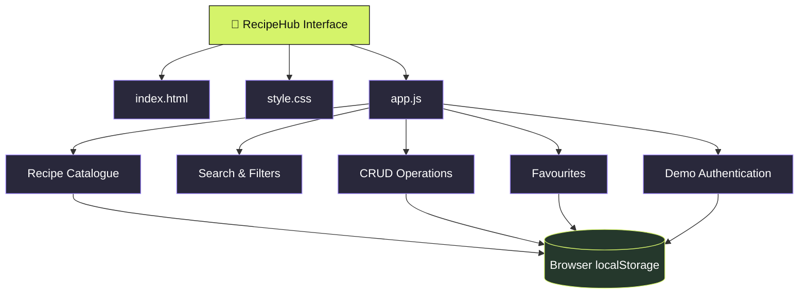

<div align="center">


<br/>

### 🍳 A little inspiration. A lot of flavour.

A modern, interactive recipe discovery experience featuring beautiful visuals, smooth animations, and simple recipe management.

<br/>

<a href="https://recipehub-capstone.onrender.com">
  
</a>
<a href="https://github.com/sania28/recipehub-capstone">
  
</a>

<br/><br/>


</div>

---

## ✨ The Experience

**RecipeHub** is a front-end recipe discovery application designed to make exploring, saving, and managing food recipes an enjoyable experience.

From quick breakfasts to delicious desserts, discover inspiration through a sleek dark interface, vibrant accents, interactive recipe cards, and responsive layouts.

The project combines practical JavaScript functionality with a premium visual style inspired by modern digital products.

## 💎 Features

<table>
<tr>
<td width="50%" valign="top">

### 🍽️ Discover
- Browse curated recipes
- Search by name and ingredients
- Filter by food category
- Sort alphabetically or by cooking time

</td>
<td width="50%" valign="top">

### ❤️ Personalise
- Add custom recipes
- Edit recipe information
- Delete recipes
- Save favourite dishes

</td>
</tr>
<tr>
<td width="50%" valign="top">

### ⚡ Interact
- Simulated sign-in and sign-out
- Interactive controls
- Persistent browser storage
- Instant interface updates

</td>
<td width="50%" valign="top">

### 🎨 Visual Design
- Premium dark aesthetic
- Animated hero section
- Floating visual elements
- 3D-inspired card hover effects
- Responsive mobile layout

</td>
</tr>
</table>

## 🎨 Design Highlights

<div align="center">

| Visual Element | Experience |
|:---:|---|
| 🌌 | Dark interface with vibrant lime and purple accents |
| 🪄 | Animated header and floating visual elements |
| 🧊 | Depth-inspired cards with interactive hover transforms |
| 📱 | Responsive layouts for desktop and mobile |
| ✨ | Smooth transitions and subtle entrance animations |

</div>

## 🧰 Tech Stack

<div align="center">


</div>

- **HTML5** — Semantic page structure
- **CSS3** — Responsive layouts, transitions, animations, and visual effects
- **Vanilla JavaScript** — Search, filtering, sorting, favourites, and CRUD functionality
- **localStorage** — Browser-based persistence
- **Render** — Static website hosting

## 🏗️ Architecture



## 🚀 Getting Started

Run RecipeHub locally in just a few steps.

**1. Clone the repository**

```bash
git clone https://github.com/sania28/recipehub-capstone.git
```

**2. Open the project folder**

```bash
cd recipehub-capstone
```

**3. Launch the application**

Open `index.html` in your web browser. No package installation or build process is required.

## 📂 Project Structure

```text
recipehub-capstone/
├── index.html    # Application structure
├── style.css     # Styling, animations and responsive design
├── app.js        # Interactive functionality and data management
└── README.md     # Project documentation
```

## 💾 Data Persistence

RecipeHub uses the browser's `localStorage` to retain recipe data, favourite selections, and demo sign-in information across page refreshes in the same browser.

**Important:** Data is browser-specific and is not synchronised across users or devices. Authentication is simulated for demonstration purposes and is not secure production authentication.

## 🌍 Live Deployment

<div align="center">

### Your next favourite recipe is waiting.

<a href="https://recipehub-capstone.onrender.com">
  
</a>

**Live URL:** https://recipehub-capstone.onrender.com

Deployed as a static site on Render.

</div>

## 🎯 Project Objectives

- Build a complete interactive front-end application.
- Practise DOM manipulation and JavaScript event handling.
- Implement create, read, update, and delete operations.
- Persist application state using browser storage.
- Develop a responsive and visually polished user experience.
- Publish a live application and document its architecture.

## 👩‍💻 About the Developer

<div align="center">

### Sania Mujtaba

Aspiring Software Developer | Computer Science Engineering

<a href="https://github.com/sania28">
  
</a>
<a href="https://www.linkedin.com/in/sania-mujtaba-20806a394/">
  
</a>

</div>

---

<div align="center">

Made with ❤️, creativity, and a passion for building delightful web experiences.

**RecipeHub · Discover Something Delicious 🍳**


</div>

